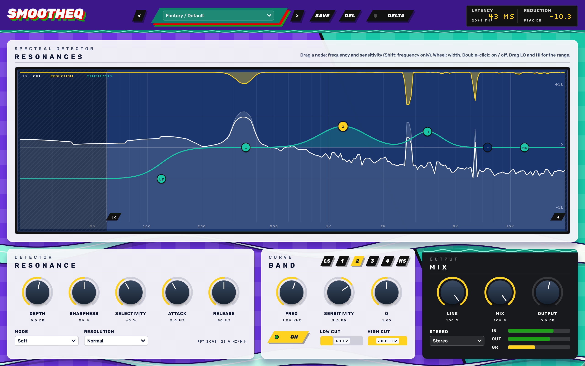
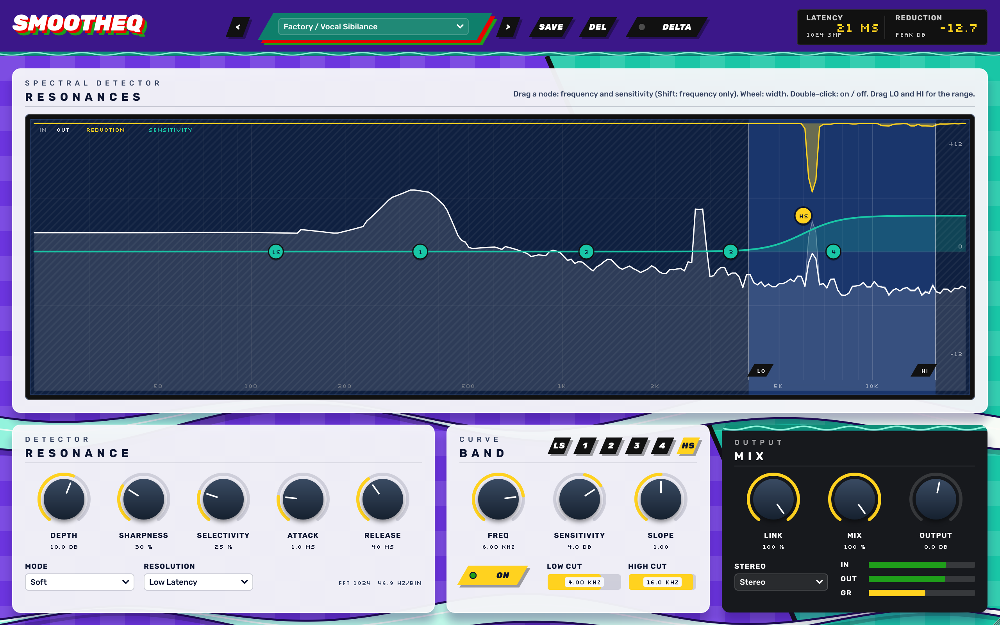

# SMOOTHEQ

Soppressore **dinamico di risonanze** in formato **VST3 / AU** per Windows e macOS (C++ / JUCE 8). Trova da solo, frame per frame, le frequenze che sporgono rispetto al loro intorno (fischi, nasalità, sibilanti aspre, rimbombi di stanza, ring dei tamburi) e le abbassa solo quando e quanto sporgono. Il resto dello spettro resta com'è.

Fa parte della stessa famiglia grafica di [SONIC GRAIN](https://github.com/gianlucasofia90/SONICGRAIN), [DR. SEGG-UENCER](https://github.com/gianlucasofia90/dr.segg-uencer) e [MULTITAILS](https://github.com/gianlucasofia90/multitails): stessa toolchain e stesso design system (piastre inclinate, manopole scure con l'arco giallo, letture in font pixel, titoli di sezione solo testo), qui su fondo viola con una fascia verde acqua e nastri di seta.



| Preset Vocal Sibilance, range 4-16 kHz |
|---|
|  |

## Riferimenti
Prende idee da diversi plugin commerciali e gratuiti, senza copiarne nessuno:

| Plugin | Cosa ne viene |
|---|---|
| oeksound soothe2 | rilevamento spettrale rispetto all'intorno, `Depth`, `Sharpness`, `Selectivity`, attack e release, `Delta`, modi Mid / Side, curva di sensibilità a nodi |
| Waves Curves Equator | curva disegnata direttamente sullo spettro, nodi trascinabili, rotella per la larghezza |
| Baby Audio Smooth Operator / Pro | la curva come "bilanciamento" di dove il processore lavora di più o di meno |
| Mastering The Mix RESO | la riduzione disegnata sopra lo spettro, così si vede subito dove interviene |
| Voxengo TEOTE | default che funzionano senza toccare niente; knee morbido |
| Tokyo Dawn Labs TDR Nova, Wavegroove Vasis, DSEQ | range di lavoro come in un EQ dinamico, risoluzione selezionabile, modo Soft / Hard |

## Come funziona
```
Input ─┬─ [ STFT ] ─ rilevatore ─ attack/release ─ link ─ smoothing ─ guadagno per bin ─ [ ISTFT ] ─┬─ Mix ─ Output
       └───────────────────────────── dry ritardato della latenza ──────────────────────────────────┘
```
Ogni quarto di finestra il segnale passa per una FFT (finestra di Hann, sovrapposizione 75 %). Per ogni bin il rilevatore confronta il livello con la media del suo intorno su un asse logaritmico (la "baseline"): quello che sporge oltre la soglia di `Selectivity` è una risonanza, e quel bin viene abbassato dell'eccesso, al massimo di `Depth`, moltiplicato per la curva di sensibilità. La riduzione si muove con `Attack` e `Release` e viene ammorbidita tra bin vicini, poi moltiplica lo spettro. Con niente da ridurre l'uscita è l'ingresso ritardato, bit per bit entro 1e-6 (verificato dai test).

## Controlli

### Resonance (rilevatore)
| Controllo | Cosa fa |
|---|---|
| **Depth** | Quanto al massimo viene abbassata una risonanza (0-24 dB). È il controllo principale: parti da qui. |
| **Sharpness** | Larghezza dell'intorno con cui si confronta ogni frequenza: da 2 ottave (0 %, anche le gobbe larghe contano) a 1/6 di ottava (100 %, solo i picchi stretti). |
| **Selectivity** | Quanto deve sporgere un picco prima di essere toccato (da 0,5 a 12 dB). Alta = interviene solo sulle risonanze evidenti. |
| **Attack / Release** | Velocità con cui la riduzione arriva e se ne va. |
| **Mode** | `Soft`: le piccole sporgenze vengono ridotte meno (knee morbido). `Hard`: riduzione piena appena si supera la soglia. |
| **Resolution** | `Low Latency` (FFT 1024 a 48 kHz, 21 ms), `Normal` (2048, 43 ms), `High Res` (4096, 85 ms). Alle frequenze di campionamento alte la FFT raddoppia, così la risoluzione in Hz resta la stessa. Più risoluzione = più precisione sui bassi e più latenza. |

### Band (curva di sensibilità)
Sei nodi: low shelf (`LS`), quattro campane (`1`-`4`) e high shelf (`HS`). Non sono un EQ: decidono **dove il rilevatore lavora di più o di meno**. +6 dB raddoppia la riduzione in quella zona, -6 dB la dimezza, -12 dB la riduce a un quarto.

- Sul display: trascina un nodo (Shift = solo frequenza), rotella per la larghezza (`Q` o `Slope` per gli shelf), doppio clic per accenderlo o spegnerlo.
- Nel pannello: `Freq`, `Sensitivity`, `Q` / `Slope`, `ON`, e il **range** `Low Cut` / `High Cut`: fuori dal range non succede niente (con una sfumatura di un terzo d'ottava). Anche le linguette `LO` e `HI` sul display si trascinano.

### Mix (uscita)
| Controllo | Cosa fa |
|---|---|
| **Link** | Quanto i due canali condividono la riduzione (100 % = l'immagine stereo non si sposta). |
| **Mix** | Dry/wet, con il dry già allineato alla latenza. |
| **Output** | Guadagno d'uscita, ±12 dB. |
| **Stereo** | `Stereo` (L/R), `Mid` (solo il centro), `Side` (solo i lati), `Mid/Side` (centro e lati separati). |
| **DELTA** (nell'header) | Fa sentire solo quello che viene tolto: utile per capire se si sta togliendo troppo. |

Il display mostra lo spettro d'ingresso (bianco pieno), l'uscita (linea bianca), la riduzione che scende dall'alto (giallo) e la curva di sensibilità (verde acqua). Nell'header: latenza e riduzione di picco.

## Preset
Default, Vocal De-Harsh, Vocal Sibilance, Vocal Boxy Room, Podcast Voice, Acoustic Guitar Body, Electric Guitar Fizz, Drum Room Ring, Cymbal Tamer, Bass Mud, Strings Smooth, Synth Whistle Hunter, Mix Bus Glue, Master Gentle, Wide Harsh Sides. Sono punti di partenza: regola prima `Depth`, poi `Selectivity`. I preset utente si salvano con `SAVE` in `~/Music/SmoothEQ Presets` (file `.smeq`).

## Download
Ogni tag `v*` pubblica una Release con:
- macOS: installer `.pkg` con VST3 e AU, oppure VST3, AU e AAX non firmato in zip (universal arm64 + x86_64, da macOS 10.13 High Sierra);
- Windows: VST3 (`C:\Program Files\Common Files\VST3`);
- Linux: VST3.

**macOS**: le build non sono firmate con un Developer ID né notarizzate, quindi macOS le blocca come file scaricati da internet. Il modo più semplice è l'installer:
1. Scarica `SmoothEQ-…-macOS-Installer.pkg` e aprilo. macOS lo blocca.
2. Vai in Impostazioni di Sistema → Privacy e sicurezza, premi `Apri comunque` e completa l'installazione.
3. Nella DAW fai una nuova scansione dei plugin.

Se preferisci gli zip, dopo aver copiato i plugin togli la quarantena dal Terminale:
```bash
xattr -dr com.apple.quarantine ~/Library/Audio/Plug-Ins/VST3/"SMOOTHEQ.vst3" ~/Library/Audio/Plug-Ins/Components/"SMOOTHEQ.component"
```

**AAX**: Pro Tools carica nella versione normale solo plugin firmati con PACE.

**VST2**: non viene compilato di default, perché lo SDK Steinberg non è più distribuito. Se hai una copia con licenza: `-DSMOOTHEQ_VST2_SDK=/percorso/vstsdk2.4`.

## Compilare
Servono CMake ≥ 3.22, un compilatore C++17 e git. JUCE 8.0.10 viene scaricato in automatico; per usarne una copia locale aggiungi `-DJUCE_DIR=/percorso/JUCE`.

```bash
cmake -B build -DCMAKE_BUILD_TYPE=Release            # -DSMOOTHEQ_BUILD_AAX=ON  -DSMOOTHEQ_BUILD_TESTS=ON
cmake --build build --config Release
```
- I plugin vengono copiati nelle cartelle plug-in dell'utente (si disattiva con `-DSMOOTHEQ_COPY_AFTER_BUILD=OFF`).
- **Mac senza Terminale**: doppio clic su `scripts/build-mac.command`, poi `scripts/verify-au.command` per auval.

### Pubblicare una versione
Doppio clic su `scripts/release.bat` (Windows) o `scripts/release.command` (macOS): aggiorna la versione in `CMakeLists.txt`, aggiunge la voce nel CHANGELOG se manca, fa push e crea il tag `vX.Y.Z`. La CI pubblica la Release.

### Test
```bash
cmake -B build -DSMOOTHEQ_BUILD_TESTS=ON && cmake --build build --config Release
build/Tests/SmoothEQTests_artefacts/Release/SmoothEQTests
build/Tests/SmoothEQTests_artefacts/Release/SmoothEQTests --snap snap.png 2 -1 2   # banda selezionata, preset (-1 = demo), scala
```
I test controllano: null test a 44,1-192 kHz su tutte le risoluzioni, mono e stereo; riduzione di una risonanza (circa `Depth`) con il rumore intorno intatto; rumore bianco che passa senza cambiare livello; curva e range; `Delta` (uscita + delta = dry); modi Mid e Side e `Link`; indipendenza dalla dimensione del blocco; bypass allineato alla latenza; cambio di risoluzione con latenza comunicata all'host; stato, preset di fabbrica e utente; ingressi estremi; editor e ridimensionamento; costo CPU. La CI passa anche pluginval a strictness 8 e auval.

## Struttura
| Percorso | Contenuto |
|---|---|
| `Source/SmoothCore.h` | FFT, curva di sensibilità, costanti (senza JUCE) |
| `Source/SmoothEngine.h` | STFT, rilevatore, riduzione, mix e delta (senza JUCE, real-time safe) |
| `Source/Params.h` | id dei parametri e liste |
| `Source/SmoothProcessor.*` | parametri, stato, preset, latenza |
| `Source/SmoothUI.h`, `Source/SmoothEditor.h` | grafica, display dello spettro e layout |
| `Tests/` | test headless e snapshot dell'editor |

## Licenza
JUCE 8 è distribuito sotto AGPLv3 o licenza commerciale. Per distribuire i binari serve una licenza JUCE commerciale, oppure rilasciare questo codice sotto AGPLv3. I font sono SIL Open Font License. VST è un marchio di Steinberg Media Technologies GmbH. soothe2, Curves Equator, Smooth Operator, DSEQ, RESO, TEOTE, TDR Nova e Vasis sono marchi dei rispettivi proprietari, citati solo come riferimento: SMOOTHEQ non è affiliato a nessuno di loro.
